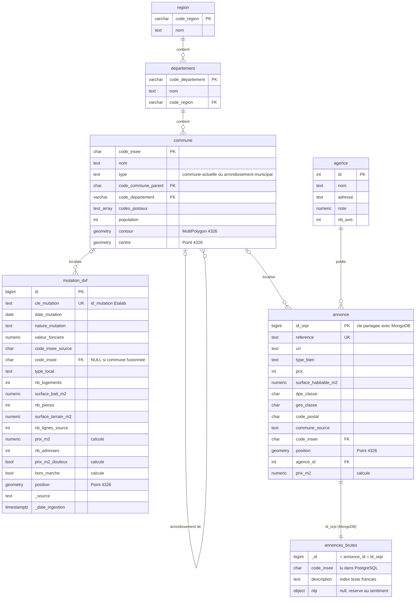

# Schéma des bases de données Homepedia

Deux bases, une clé commune : le **code INSEE de la commune** (5 caractères).

| Base | Techno | Contenu | Pourquoi |
|---|---|---|---|
| Relationnelle | PostgreSQL 17 + PostGIS 3.5 | Référentiel géographique, transactions DVF, champs structurés des annonces Orpi | Données tabulaires, jointures, intégrité, requêtes spatiales |
| Non relationnelle | MongoDB 8.0 | Annonces Orpi brutes (description en texte libre) | Structure variable, recherche plein texte, champ NLP à venir |

Sources de vérité : `db/postgres/schema.sql` (tables et index), `db/load_dvf.py` (ventes DVF), `db/load_postgres.py` et `db/load_mongo.py` (annonces) (règles de chargement), `db/check.py` (contrôles PASS/FAIL).
L'exercice KaDo (schéma étoile) vit à part dans le schéma PostgreSQL `kado` (`db/postgres/kado.sql`, `bootstrap/docs/schema/schema_kado.md`).

---

## 1. Diagramme

Les colonnes d'`annonce` non listées (surfaces, pièces, équipements booléens, DPE, dates) sont dans `db/postgres/schema.sql`.

---

## 2. Relationnel ou NoSQL : le choix par type de donnée

| Donnée | Base | Raison |
|---|---|---|
| Régions, départements, communes + contours | PostgreSQL | Hiérarchie à clés étrangères, géométries et requêtes spatiales (PostGIS) |
| Transactions DVF (5,6 M ventes, 2022-2025) | PostgreSQL | Tabulaire, agrégats par commune et par date, jointure avec le référentiel |
| Champs structurés d'une annonce (prix, surface, DPE, position) | PostgreSQL | Mêmes besoins que DVF : filtres, jointure par code INSEE, comparaison avec les ventes |
| Annonce brute : description libre, structure qui peut changer d'un scraping à l'autre | MongoDB | Pas de schéma fixe, recherche plein texte, ajout du champ `nlp` sans migration |

Le lien entre les deux bases est `annonce.id_orpi` = `annonces_brutes._id`. Chaque annonce existe des deux côtés, sans contenu dupliqué : Postgres garde les champs filtrables, Mongo garde le texte et le brut.

---

## 3. Standardisation (règles appliquées au chargement)

| Sujet | Règle | Où |
|---|---|---|
| Code INSEE | 5 caractères, texte. DVF Etalab fournit déjà le code commune actuel sur 5 caractères ; tout est lu en texte (zéros de tête conservés) | `load_dvf.py` |
| Code d'origine conservé | `mutation_dvf.code_insee_source` garde le code lu ; `code_insee` est NULL si la commune n'existe pas dans le référentiel (32 à 97 codes par an selon l'année, communes fusionnées) | `schema.sql`, `check.py` |
| Paris, Lyon, Marseille | DVF est codé par arrondissement. Les 45 arrondissements sont des lignes de `commune` (`type = 'arrondissement-municipal'`) qui pointent vers leur commune parente | `schema.sql` |
| Dates | DVF Etalab déjà en `aaaa-mm-jj` ; dates ISO 8601 d'Orpi tronquées à la date | `load_dvf.py`, `load_postgres.py` |
| Nombres | Point décimal (DVF Etalab, Orpi) ; le CSV du bootstrap, en virgule, n'est plus chargé en base | `load_dvf.py` |
| Code postal Orpi | Complété à 5 caractères ; `00000` (annonce hors France) → NULL | `load_postgres.py` |
| Valeurs absentes | Prix non affiché → NULL ; note d'agence 0 sans avis → NULL (pas « noté 0/5 ») ; jamais de 0 par défaut | `load_postgres.py` |
| Données personnelles | Téléphone et e-mail d'agence jamais chargés, ni dans Postgres ni dans Mongo | `load_postgres.py`, `load_mongo.py` |

### Code INSEE d'une annonce Orpi

La position GPS d'Orpi est approximative (jusqu'à ~1,1 km). Le code INSEE est donc résolu par ordre de fiabilité, les cas non résolus restent NULL et sont comptés, jamais devinés :

1. nom de commune + code postal ;
2. nom de commune à moins de 5 km du point GPS ;
3. code postal qui ne couvre qu'une seule commune ;
4. point GPS dans le contour d'une commune ;
5. descente à l'arrondissement (Paris, Lyon, Marseille) par code postal, puis par GPS.

Sur les 500 annonces : 2 restent sans commune (annonces hors France).

### Ventes DVF : source et regroupement (depuis le 2026-11-14)

**Source** : DVF géolocalisées (Etalab, data.gouv.fr), dérivées des DVF de la DGFiP, années complètes **2022 à 2025**. Téléchargement : `db/telecharger_dvf.py` ; chargement : `db/load_dvf.py`. Une année est toujours rechargée en entier, dans une seule transaction (`id_mutation` d'Etalab n'est pas stable d'une livraison à l'autre).

Le fichier a une ligne par lot, par local ou par nature de culture d'une parcelle ; la valeur foncière est répétée sur chaque ligne d'une même vente. Une ligne de `mutation_dvf` = une vente.

- **Clé** : `id_mutation` d'Etalab (`cle_mutation`). Elle remplace la clé reconstruite du bootstrap (date + INSEE + nature + valeur), qui pouvait fusionner deux ventes.
- **Aucune ligne perdue** : `sum(nb_lignes_source)` = nombre de lignes du fichier, année par année (contrôlé dans `check.py`).
- **Logement** : (parcelle, type, surface, pièces, n° de lot). DVF répète un même logement sur autant de lignes que sa parcelle a de natures de culture (sol, jardin…). Le nombre de logements identiques est donc le nombre de lignes **pour une même culture** (le maximum sur les cultures) :
  - compter toutes les lignes faisait passer 114 795 ventes 2022 (10 % des ventes avec logement, surtout des maisons avec jardin) pour des ventes de 2 logements, exclues à tort des prix au m² ;
  - compter les logements distincts fusionnait des logements identiques sur une même parcelle (même surface, mêmes pièces, sans n° de lot) : 6 588 ventes 2022 passaient pour des ventes d'un logement, avec un prix au m² faussé.
- **Type de bien** : `Maison` ou `Appartement` si la vente en contient ; `Mixte` si les deux ; sinon local d'activité ou autre.
- **Surface** : somme des surfaces bâties des logements (logements identiques comptés autant de fois qu'ils existent). Terrain : somme sur les couples (parcelle, nature de culture) distincts.
- **Commune** : celle du logement quand la vente porte sur plusieurs communes (~15 000 ventes par an), sinon le plus petit code.
- **Nature** : une ligne hors marché (échange, adjudication…) rend toute la vente hors marché, son prix unique n'étant pas un prix de marché (21 à 30 ventes par an mêlent les deux).
- **Position** : moyenne des points des logements de la vente (à défaut, de ses parcelles) ; `position` Point 4326, index GiST.
- **Prix au m²** : `valeur_fonciere / surface_bati_m2`, colonne générée. Il n'a de sens que pour `nb_logements = 1`.

| Année | Lignes du fichier | Ventes | Ventes d'un logement | `prix_m2_douteux` | `hors_marche` | Codes absents du référentiel (ventes) |
|---|---|---|---|---|---|---|
| 2022 | 4 676 187 | 1 688 428 | 1 058 486 | 9 760 | 25 237 | 97 (3 332) |
| 2023 | 3 817 426 | 1 361 455 | 831 125 | 7 773 | 22 567 | 83 (2 519) |
| 2024 | 3 499 931 | 1 229 371 | 748 805 | 6 772 | 20 494 | 72 (1 739) |
| 2025 | 3 714 829 | 1 314 051 | 835 494 | 7 067 | 17 592 | 32 (731) |

**Réconciliation avec le CSV du bootstrap (2022)** : le bootstrap compte 3 803 885 lignes, soit 81 % du millésime 2022 actuel, avec une complétude qui baisse mois par mois (98 % en janvier, 51 % en décembre). C'est un extrait d'une livraison DGFiP précoce, publiée avant l'enregistrement des actes de fin d'année. Les chiffres du Follow-up 1 et du Follow-up 2 (1 403 428 ventes, Île-de-France 5 000 €/m²) viennent de ce fichier ; avec la source complète, l'Île-de-France 2022 est à 4 922 €/m². Le bootstrap reste utilisé par les jobs PySpark du Follow-up 1 uniquement.

### Lignes douteuses : marquées, jamais supprimées

| Colonne | Définition | Pourquoi |
|---|---|---|
| `nb_adresses` | Adresses distinctes (voie + numéro) parmi les logements de la vente | Une vente de plusieurs logements à des adresses différentes (ex. lots d'un programme) |
| `prix_m2_douteux` | `nb_adresses > 1` | Le prix/m² d'une telle vente (une valeur divisée par la somme des surfaces) ne représente aucun logement |
| `hors_marche` | Nature différente de Vente et de Vente en l'état futur d'achèvement (échange, adjudication, expropriation, terrain à bâtir) | Ce ne sont pas des ventes de marché |

---

## 4. Index et requêtes servies

### PostgreSQL

| Table | Index | Requête servie |
|---|---|---|
| `departement` | B-tree `code_region` | Départements d'une région |
| `commune` | B-tree `code_departement` | Communes d'un département |
| `commune` | B-tree `code_commune_parent` | Arrondissements d'une commune |
| `commune` | GIN `codes_postaux` | Communes d'un code postal (tableau) |
| `commune` | GiST `contour` | « Quelle commune contient ce point ? », cartes |
| `mutation_dvf` | unique `cle_mutation` (`id_mutation` Etalab) | Une ligne par vente ; une année est remplacée en entier au rechargement |
| `mutation_dvf` | GiST `position` | Ventes dans un rayon ou un contour (cartes de densité, scoring) |
| `mutation_dvf` | B-tree `(code_insee, date_mutation)` | Ventes d'une commune sur une période |
| `mutation_dvf` | B-tree `type_local` | Filtre par type de bien |
| `mutation_dvf` | B-tree partiel `(code_insee, prix_m2)` où `nb_logements = 1` | Prix/m² médian par commune sur les ventes d'un seul logement |
| `annonce` | B-tree `code_insee` | Annonces d'une commune, jointure avec DVF |
| `annonce` | B-tree `type_bien`, `agence_id` | Filtre par type, annonces d'une agence |
| `annonce` | GiST `position` | Annonces dans un rayon ou un contour |
| `annonce`, `agence` | unique `reference` ; unique `(nom, adresse)` | Idempotence du chargement |

La colonne `commune.centre` n'a pas d'index : elle sert à l'affichage, pas à la recherche.

### MongoDB (`annonces_brutes`)

| Index | Requête servie |
|---|---|
| `code_insee` | Annonces d'une commune |
| texte sur `description`, langue française | Recherche plein texte (ex. « balcon » : 80 annonces sur 500) |

---

## 5. Requête croisée par code INSEE

Prix/m² médian des appartements, ventes DVF face aux annonces Orpi, par commune (`REQUETE_CROISEE` dans `db/check.py`) : **135 communes** ont les deux. La plupart n'ont que 1 à 7 annonces : l'écart prix demandé / prix vendu n'est pas significatif commune par commune, il faudra agréger plus haut (département, région).

---

## 6. Limites connues

- Le référentiel vient de geo.api.gouv.fr, pas d'Admin Express : pas d'EPCI.
- DVF 2022-2025 : 32 à 97 codes commune par an absents du référentiel (fusions de communes), ventes conservées et comptées.
- Environ 0,7 à 1,1 % des ventes n'ont pas de position (parcelle non géocodée par Etalab).
- La position GPS des annonces est approximative ; 2 à 3 annonces de communes fusionnées sont rattachées à la commune voisine.
- Le JSON Orpi stocké dans Mongo contient 48 champs déjà extraits, pas la page complète.
- Le champ `nlp` de `annonces_brutes` est vide : le sentiment n'est pas encore calculé.
