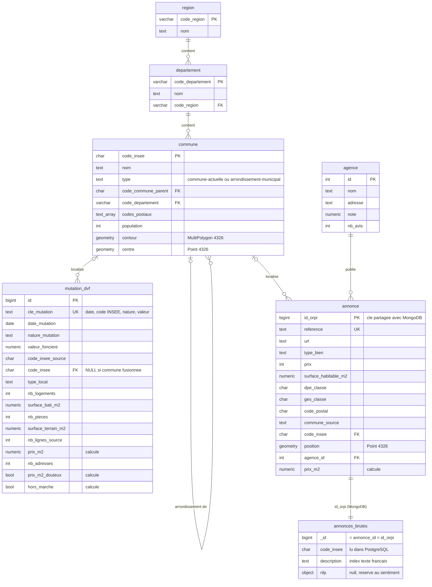

# Schéma des bases de données Homepedia

Deux bases, une clé commune : le **code INSEE de la commune** (5 caractères).

| Base | Techno | Contenu | Pourquoi |
|---|---|---|---|
| Relationnelle | PostgreSQL 17 + PostGIS 3.5 | Référentiel géographique, transactions DVF, champs structurés des annonces Orpi | Données tabulaires, jointures, intégrité, requêtes spatiales |
| Non relationnelle | MongoDB 8.0 | Annonces Orpi brutes (description en texte libre) | Structure variable, recherche plein texte, champ NLP à venir |

Sources de vérité : `db/postgres/schema.sql` (tables et index), `db/load_postgres.py` et `db/load_mongo.py` (règles de chargement), `db/check.py` (contrôles PASS/FAIL).
L'exercice KaDo (schéma étoile) vit à part dans le schéma PostgreSQL `kado` (`db/postgres/kado.sql`, `bootstrap/docs/schema/schema_kado.md`).

---

## 1. Diagramme

Les colonnes d'`annonce` non listées (surfaces, pièces, équipements booléens, DPE, dates) sont dans `db/postgres/schema.sql`.

---

## 2. Relationnel ou NoSQL : le choix par type de donnée

| Donnée | Base | Raison |
|---|---|---|
| Régions, départements, communes + contours | PostgreSQL | Hiérarchie à clés étrangères, géométries et requêtes spatiales (PostGIS) |
| Transactions DVF (1,4 M mutations) | PostgreSQL | Tabulaire, agrégats par commune et par date, jointure avec le référentiel |
| Champs structurés d'une annonce (prix, surface, DPE, position) | PostgreSQL | Mêmes besoins que DVF : filtres, jointure par code INSEE, comparaison avec les ventes |
| Annonce brute : description libre, structure qui peut changer d'un scraping à l'autre | MongoDB | Pas de schéma fixe, recherche plein texte, ajout du champ `nlp` sans migration |

Le lien entre les deux bases est `annonce.id_orpi` = `annonces_brutes._id`. Chaque annonce existe des deux côtés, sans contenu dupliqué : Postgres garde les champs filtrables, Mongo garde le texte et le brut.

---

## 3. Standardisation (règles appliquées au chargement)

| Sujet | Règle | Où |
|---|---|---|
| Code INSEE | 5 caractères, texte. Département complété à 2 caractères, commune à 3. Pour les DOM (département de 3 caractères) : département + 2 derniers chiffres de la commune (97101) | `load_postgres.py` |
| Code d'origine conservé | `mutation_dvf.code_insee_source` garde le code lu ; `code_insee` est NULL si la commune n'existe pas dans le référentiel (94 codes, communes fusionnées après 2022) | `schema.sql`, `check.py` |
| Paris, Lyon, Marseille | DVF est codé par arrondissement. Les 45 arrondissements sont des lignes de `commune` (`type = 'arrondissement-municipal'`) qui pointent vers leur commune parente | `schema.sql` |
| Dates | `jj/mm/aaaa` (DVF) → `aaaa-mm-jj` ; dates ISO 8601 d'Orpi tronquées à la date | `load_postgres.py` |
| Nombres | Virgule décimale → point (`"55000,00"` → `55000.00`) | `load_postgres.py` |
| Code postal Orpi | Complété à 5 caractères ; `00000` (annonce hors France) → NULL | `load_postgres.py` |
| Valeurs absentes | Prix non affiché → NULL ; note d'agence 0 sans avis → NULL (pas « noté 0/5 ») ; jamais de 0 par défaut | `load_postgres.py` |
| Données personnelles | Téléphone et e-mail d'agence jamais chargés, ni dans Postgres ni dans Mongo | `load_postgres.py`, `load_mongo.py` |

### Code INSEE d'une annonce Orpi

La position GPS d'Orpi est approximative (jusqu'à ~1,1 km). Le code INSEE est donc résolu par ordre de fiabilité, les cas non résolus restent NULL et sont comptés, jamais devinés :

1. nom de commune + code postal ;
2. nom de commune à moins de 5 km du point GPS ;
3. code postal qui ne couvre qu'une seule commune ;
4. point GPS dans le contour d'une commune ;
5. descente à l'arrondissement (Paris, Lyon, Marseille) par code postal, puis par GPS.

Sur les 500 annonces : 2 restent sans commune (annonces hors France).

### Regroupement DVF en mutations

Le CSV DVF a une ligne par lot ou par parcelle ; la valeur foncière est répétée sur chaque ligne d'un même acte. Une ligne de `mutation_dvf` = un acte.

- **Clé** : date + code INSEE + nature + valeur (`cle_mutation`, unique). Le CSV n'a ni numéro de disposition ni identifiant de mutation. Ajouter section et numéro de plan scindait les actes multi-parcelles : 2 362 399 « mutations » au lieu de 1 403 428 sur DVF 2022.
- **Aucune ligne perdue** : `sum(nb_lignes_source)` = 3 803 885 lignes du CSV (contrôlé dans `check.py`).
- **Type de bien** : `Maison` ou `Appartement` si l'acte en contient ; `Mixte` si les deux ; sinon local d'activité ou autre.
- **Surface** : somme des surfaces bâties des logements de l'acte. Le terrain est sommé sur les parcelles distinctes.
- **Prix au m²** : `valeur_fonciere / surface_bati_m2`, colonne générée. Il n'a de sens que pour `nb_logements = 1`.

### Lignes douteuses : marquées, jamais supprimées

| Colonne | Définition | Pourquoi |
|---|---|---|
| `nb_adresses` | Adresses distinctes (voie + numéro) parmi les logements de l'acte | Deux ventes d'un même programme neuf (même jour, même commune, même prix) peuvent être fusionnées par la clé |
| `prix_m2_douteux` | `nb_adresses > 1` (11 613 mutations sur DVF 2022) | Le prix/m² d'un acte fusionné est sous-estimé (une valeur divisée par la somme des surfaces) |
| `hors_marche` | Nature différente de Vente et de Vente en l'état futur d'achèvement (18 874 mutations : échange, adjudication, expropriation, terrain à bâtir) | Ce ne sont pas des ventes de marché |

---

## 4. Index et requêtes servies

### PostgreSQL

| Table | Index | Requête servie |
|---|---|---|
| `departement` | B-tree `code_region` | Départements d'une région |
| `commune` | B-tree `code_departement` | Communes d'un département |
| `commune` | B-tree `code_commune_parent` | Arrondissements d'une commune |
| `commune` | GIN `codes_postaux` | Communes d'un code postal (tableau) |
| `commune` | GiST `contour` | « Quelle commune contient ce point ? », cartes |
| `mutation_dvf` | unique `cle_mutation` | Rejouer le chargement sans doublon (upsert) |
| `mutation_dvf` | B-tree `(code_insee, date_mutation)` | Ventes d'une commune sur une période |
| `mutation_dvf` | B-tree `type_local` | Filtre par type de bien |
| `mutation_dvf` | B-tree partiel `(code_insee, prix_m2)` où `nb_logements = 1` | Prix/m² médian par commune sur les ventes d'un seul logement |
| `annonce` | B-tree `code_insee` | Annonces d'une commune, jointure avec DVF |
| `annonce` | B-tree `type_bien`, `agence_id` | Filtre par type, annonces d'une agence |
| `annonce` | GiST `position` | Annonces dans un rayon ou un contour |
| `annonce`, `agence` | unique `reference` ; unique `(nom, adresse)` | Idempotence du chargement |

La colonne `commune.centre` n'a pas d'index : elle sert à l'affichage, pas à la recherche.

### MongoDB (`annonces_brutes`)

| Index | Requête servie |
|---|---|
| `code_insee` | Annonces d'une commune |
| texte sur `description`, langue française | Recherche plein texte (ex. « balcon » : 80 annonces sur 500) |

---

## 5. Requête croisée par code INSEE

Prix/m² médian des appartements, ventes DVF face aux annonces Orpi, par commune (`REQUETE_CROISEE` dans `db/check.py`) : **135 communes** ont les deux. La plupart n'ont que 1 à 7 annonces : l'écart prix demandé / prix vendu n'est pas significatif commune par commune, il faudra agréger plus haut (département, région).

---

## 6. Limites connues

- Le référentiel vient de geo.api.gouv.fr, pas d'Admin Express : pas d'EPCI.
- DVF 2022 seulement ; 94 codes commune absents du référentiel (fusions après 2022).
- La clé de mutation peut fusionner à tort ~1,3 % des mutations avec logement (voir `prix_m2_douteux`). Un DVF avec identifiant de mutation (DVF géolocalisé Etalab) la rendrait exacte.
- La position GPS des annonces est approximative ; 2 à 3 annonces de communes fusionnées sont rattachées à la commune voisine.
- Le JSON Orpi stocké dans Mongo contient 48 champs déjà extraits, pas la page complète.
- Le champ `nlp` de `annonces_brutes` est vide : le sentiment n'est pas encore calculé.
